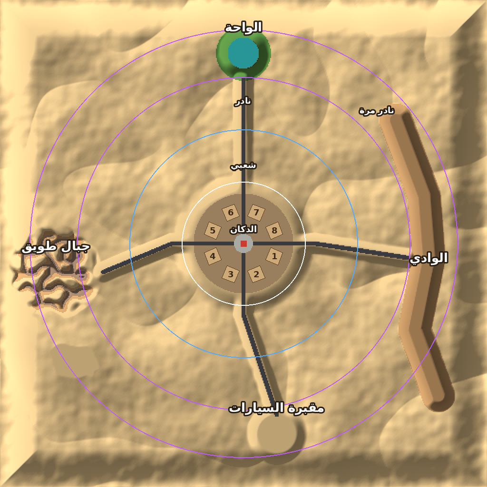
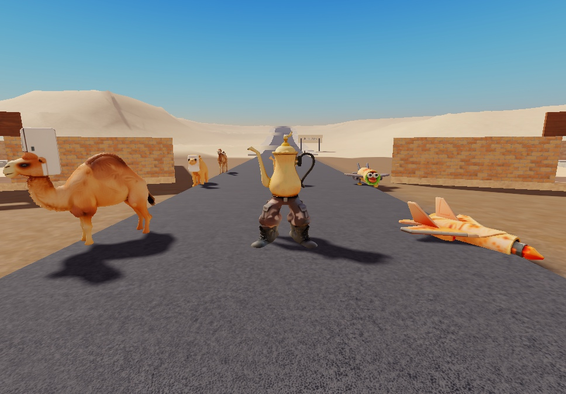
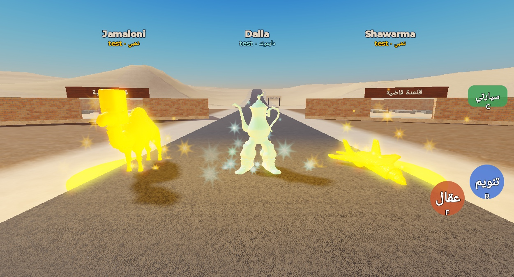
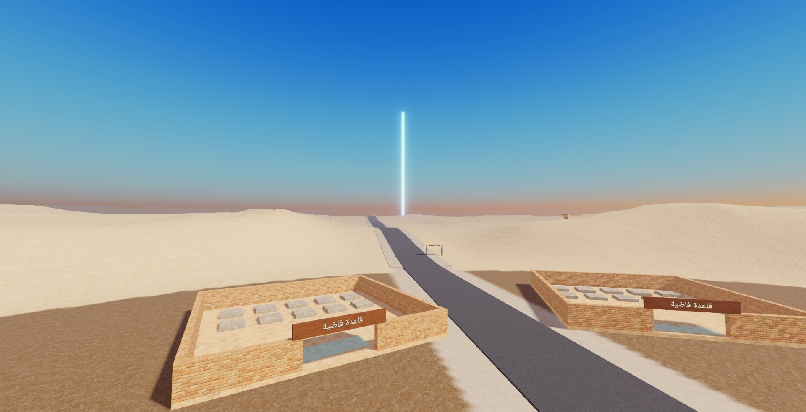
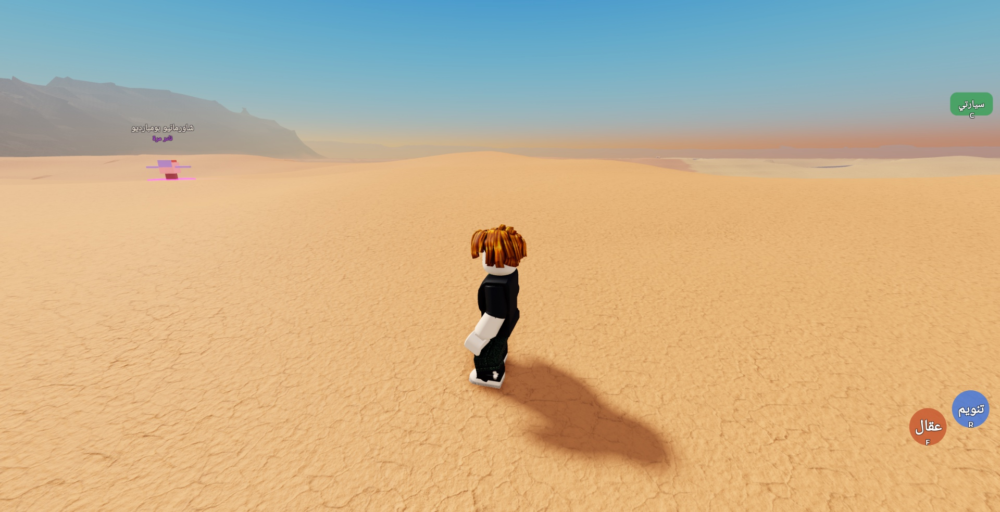
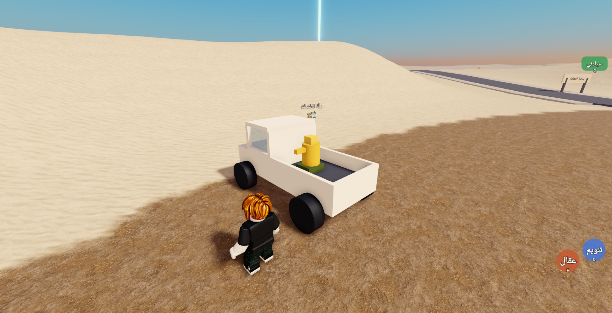
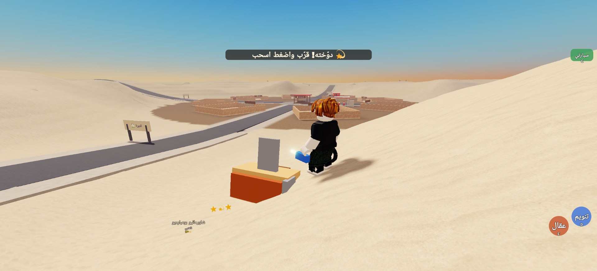

# اسرق الهبالي 🐪🧊

لعبة روبلوكس: تصيد هبالي في الصحراء، تسحبهم لقاعدتك، وتسرق من غيرك.

## المراحل

- [x] **1. الخريطة:** صحراء، الديرة، 8 قواعد، الدكان، المعالم، الطرق
- [x] **2. طلوع الهبالي في الصحراء حسب الندرة**
- [x] **3. الصيد (عقال / مسدس تنويم) والسحب للسيارة**
- [ ] 4. القواعد والسرقة والثأر
- [ ] 5. البيع عند أبو هبال وتطوير السيارات
- [ ] 6. التنبيهات، العاصفة الرملية، والإنفنتي الأسبوعي

## الخريطة



| المكان | وش فيه |
|---|---|
| **الديرة** (النص) | أرض مستوية، 8 قواعد حول **دكان أبو هبال** |
| **الثمامة** (شعبي، قريب) | من 260 إلى 1000 stud عن النص |
| **الدهناء** (نادر) | من 1000 إلى 1900 |
| **النفود** (نادر مرة) | من 1900 إلى 2700 |
| **الربع الخالي** (أسطوري، بعيد) | من 2700 إلى 3400. الرجعة طويلة، فتحتاج بنزين وسيارة قوية |
| **الواحة** (شمال) | موية ونخل |
| **الوادي** (شرق) | مجرى عميق |
| **جبال طويق** (غرب) | صخور عالية |
| **مقبرة السيارات** (جنوب) | سيارات خربانة |

الصحراء دائرية نصف قطرها تقريباً 3500، والمعالم الأربعة في الربع الخالي، ومن كل معلم يرجع للديرة طريق إسفلت.
كل الأرقام موجودة في `src/shared/MapConfig.luau` وتقدر تعدّلها.

## الهبالي





| الطبقة | الندرة | العدد في السيرفر | يطلع بداله بعد |
|---|---|---|---|
| الثمامة | شعبي | 14 | 10 ثواني |
| الدهناء | نادر | 8 | 20 ثانية |
| النفود | نادر مرة | 4 | 40 ثانية |
| الربع الخالي | أسطوري | 2 | دقيقة |

- أي هبالي ممكن يطلع **ذهبي (3%)** أو **دايموند (0.5%)**.
- يتمشون في طبقتهم بس، وما يطلعون على الطرق ولا في الديرة ولا عند المعالم.
- أول ما تدخل: يطلع لك شعبي قريب من طرف الديرة، ونادر بعيد فوقه عمود نور.



كل الأرقام في `src/shared/HabaliConfig.luau`. السكربتات في `src/server` (تروح ServerScriptService ← مجلد `Server`).

## الصيد



1. اضرب الهبالي بـ **العقال** (F)، أو نوّمه من بعيد بـ **مسدس التنويم** (R).
2. لما يدوخ (💫)، قرّب منه واضغط **اسحب**.
3. اسحبه لسيارتك واضغط **حطه في السيارة**. وزر **فلّته** (X) يتركه.
4. **سيارتي** (C) تطلّع لك سيارة الربع في موقف الديرة، و**هرن** (H) وأنت تسوق.





- الربع ما تشيل النادر مرة ولا الأسطوري، وكل ما حمّلت أكثر تمشي أبطأ.
- النادر مرة والأسطوري ممكن يصحى لما تمسكه وينطحك.
- كل الأرقام في `src/shared/CatchConfig.luau`. السكربت حق اللاعب في `src/client` (يروح StarterPlayerScripts ← مجلد `Client`).

## كيف تبني الخريطة في Studio

### الطريقة الأولى: نسخ ولصق (بدون أدوات)

1. افتح مكان جديد في Roblox Studio (قالب Baseplate).
2. في **ReplicatedStorage** سوّ مجلد (Folder) اسمه `Shared`، وداخله سوّ **ModuleScript** اثنين:
   - `MapConfig`، والصق فيه محتوى `src/shared/MapConfig.luau`
   - `DesertShape`، والصق فيه محتوى `src/shared/DesertShape.luau`
3. في **ServerStorage** سوّ مجلد اسمه `Tools`، وداخله **ModuleScript** اسمه `MapBuilder`، والصق فيه محتوى `src/tools/MapBuilder.luau`.
4. افتح **Command Bar** (من View ← Command Bar) والصق هذا السطر واضغط Enter:
   ```lua
   require(game.ServerStorage.Tools.MapBuilder).Build()
   ```
5. انتظر لين يطلع في Output: `خلصت`. التضاريس تاخذ تقريباً من 10 إلى 60 ثانية.
6. احفظ المكان (Ctrl+S).

> ⚠️ البناء يمسح التضاريس اللي في المكان ومجلد `Map` والـ Baseplate. وCtrl+Z ما يرجّع التضاريس.

### الطريقة الثانية: Rojo

```bash
rojo serve roblox/steal-the-habali/default.project.json
```
بعدها اتصل من إضافة Rojo في Studio، وشغّل نفس السطر من الخطوة 4.

## تغيير شكل الصحراء

غيّر `MapConfig.Seed` في `MapConfig.luau` وابنِ من جديد، فتطلع كثبان مختلفة بنفس التقسيم.
لو عجبك شكل، خلّ الرقم ثابت: نفس الرقم يطلع نفس الخريطة بالضبط.

## الاختبار (برا روبلوكس)

```bash
luau roblox/steal-the-habali/tests/DesertShape.test.luau
luau roblox/steal-the-habali/tests/HabaliRules.test.luau
luau roblox/steal-the-habali/tests/CatchRules.test.luau
```
يتأكد إن القواعد والطرق على أرض مستوية، وإن الطرق ما تقطع القواعد، وإن الواحة فيها موية، والوادي عميق، والأطراف عالية، وكل الارتفاعات داخل الحدود.
